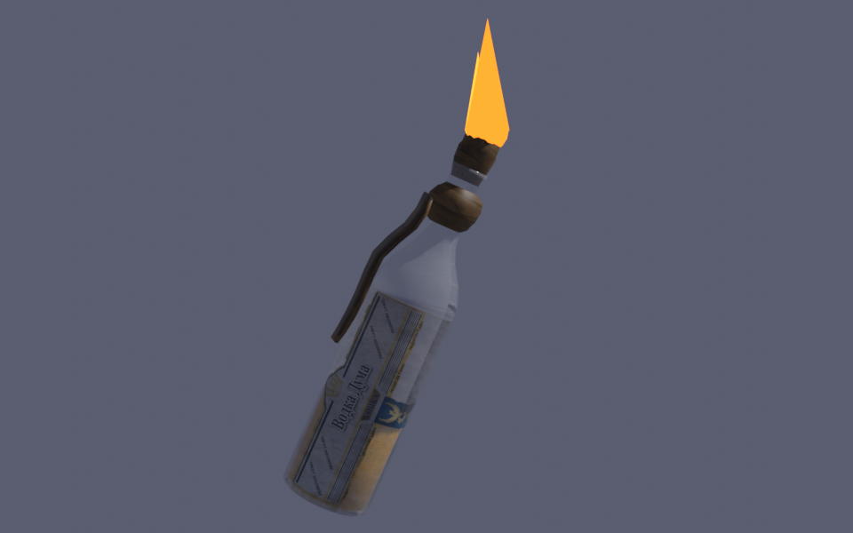

# Molotov

A molotov cocktail for DayZ, made from things you already find: a glass bottle, some
petrol and a rag. Light it, throw it, and whatever it hits burns.



## In game

- **Making one.** Fill a vanilla glass bottle with at least 200 ml of petrol or diesel
  (pour it from a jerry can), then combine it with a rag in the inventory. One rag from
  the stack goes into the neck.
- **Lighting it.** Hold the molotov with a lighter or matches anywhere in the inventory
  and use **Light the rag**. The vanilla way works too: lighter in hands, molotov on the
  ground.
- **Throwing it.** A lit molotov bursts on whatever it hits (ground, wall, car, person),
  or when it's shot, into a pool of fire about 3.5 m across that burns for 20 s.
- **Holding it too long.** 30 s after lighting it bursts by itself, at your feet if
  you're still holding it. A lit molotov can't go into the inventory.
- **The fire.** Damage goes straight to health, so clothing doesn't help:

  | Who | Per second |
  |---|---|
  | Players | 10 health, 10 shock |
  | Infected, animals | 25 health |
  | Cars (engine and fuel tank) | 5% of their health |

- **Unlit**, it's just a heavy bottle: dropping or throwing it does nothing.

The model is our own: a vodka bottle with a petrol-soaked rag knotted round the neck and
fuel up to just under half, built from vanilla textures (nothing from other mods). Its
inventory icon leans over a little.

## For server owners

The Workshop description has the step-by-step install. In short: `@Molotov` in the server
folder and on `-mod=`, `keys/tarbaby.bikey` into the server's `keys/`, and the loot entry
in `extras/types_molotov.xml` registered in the mission. The entry never spawns molotovs
(nominal 0, crafted only, like the vanilla torch); it only lets the economy keep crafted
ones.

The numbers live in `MolotovSettings` in
[`Molotov/Scripts/4_World/Molotov/Molotov.c`](Molotov/Scripts/4_World/Molotov/Molotov.c);
there is no settings file yet.

## Layout

| Path | What |
|---|---|
| `Molotov/` | The mod (PBO prefix `Molotov`): config, scripts, model, textures, Workshop files |
| `Molotov/Scripts/4_World/Molotov/` | The molotov and its fire, the Light the rag action, the recipe |
| `Molotov/Scripts/5_Mission/Molotov/` | The tilted inventory icon |
| `Molotov/extras/` | Loot entry for server admins (shipped beside `addons/`, not packed) |
| `blender/build_molotov.py` | Builds the model, `models/molotov.blend` and both previews |
| `tools/make_textures.py` | Makes the oily rag texture and material from the installed game's vanilla rag |
| `tools/build.sh` | Binarizes the model and stages the mod in `build/Molotov` |
| `mission/` | Test mission |

## Building

Needs Blender 4.2 with the Arma 3 Object Builder add-on, DayZ Tools (Binarize,
ImageToPAA), GE-Proton and Pillow. Binarize and ImageToPAA run under Proton in their own
prefix (`~/.local/share/dayz-img2paa-prefix`), never DayZ Tools' own.

```sh
tools/make_textures.py      # only when the rag texture or material changes
MOLOTOV_PREVIEW_TEX=$PWD/build/vanilla_png blender --background --python blender/build_molotov.py
tools/build.sh
```

Packing and signing is done by DayZMissions' `tools/build_mod.py`
(`~/Projects/DayZMissions/mods/Molotov` is a symlink to `build/Molotov`).

## Testing

[`mission/`](mission) is linked into DayZMissions as `missions/molotov.chernarusplus`.
Players spawn on the Chernogorsk quay with ready-made molotovs, empty and filled glass
bottles, rags, lighters, matches and jerry cans at their feet, a fuelled hatchback parked
ahead and infected coming in from 40 m.

From DayZMissions, `tools/test.sh molotov` runs it headless with `-missiontest`: it drops
lit molotovs on a clothed survivor, an infected and the car, and logs `[MolotovTest]`
lines with the fires burning and the damage done. `tools/run_server.sh molotov` and
`tools/run_client.sh molotov` start it for real.

## Releasing

The Workshop keeps only the latest upload, with no version number of its own; the version
comes from a git tag (`workshop_publish.sh` adds it to the description and change note).

1. Date the version's entry in `CHANGELOG.md`, commit, tag and push:

   ```sh
   git tag -a v0.1 -m "Molotov 0.1"
   git push origin main v0.1
   ```

2. Build: `tools/build.sh`.
3. From DayZMissions, upload it yourself (SteamCMD asks for the password and a Steam
   Guard code). The first time, run it twice: the first run creates the item and records
   its id, the second uploads the mod with that id in its `meta.cpp`.

   ```sh
   tools/workshop_publish.sh Molotov <steam login>
   ```

   SteamCMD logging in knocks the desktop Steam client offline: don't publish while
   playing, and click Steam > Go Online afterwards. Then set the tags (the launcher
   ignores items without the Mod tag). Name them: without arguments `workshop_tags.py`
   sets Mod Vehicle Mechanics.

   ```sh
   tools/workshop_tags.py Molotov Mod Weapon Equipment
   ```
4. Tell server admins to update and restart. The key stays `tarbaby.bikey`.
